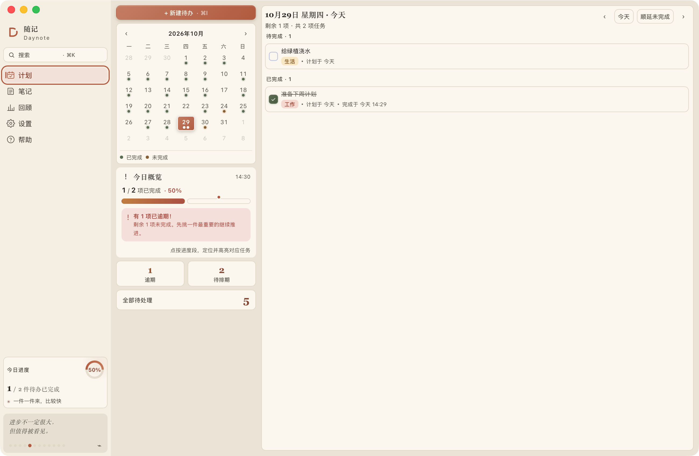
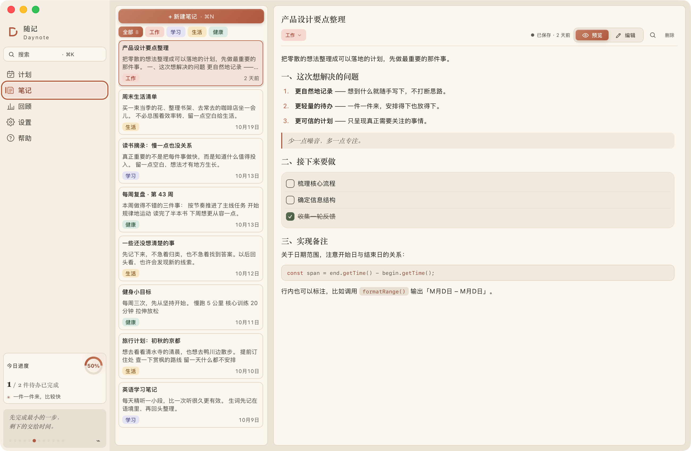
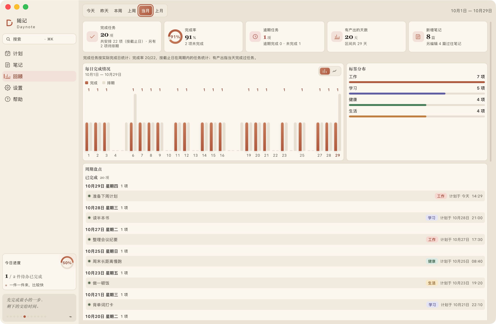
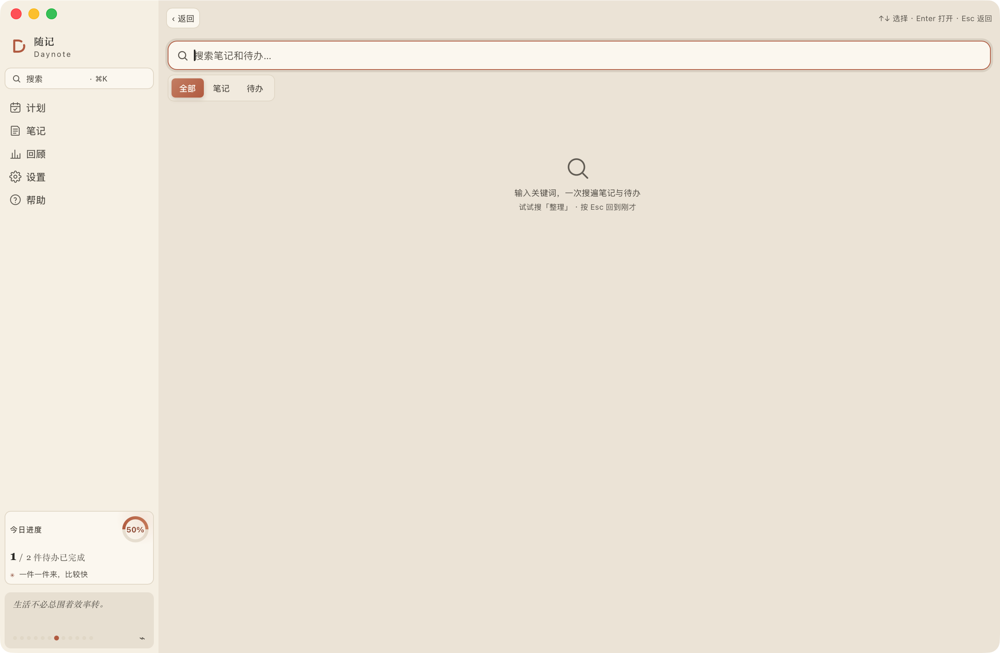
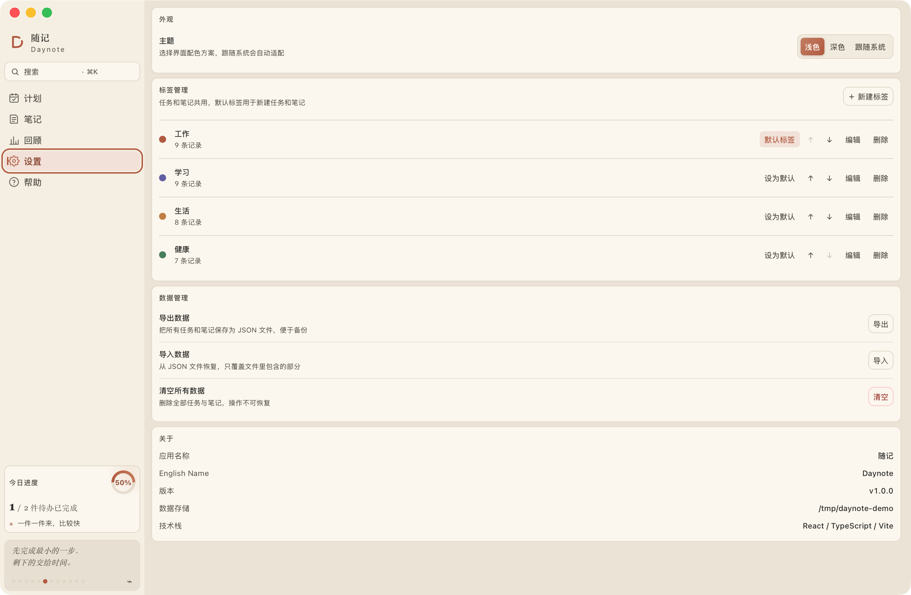
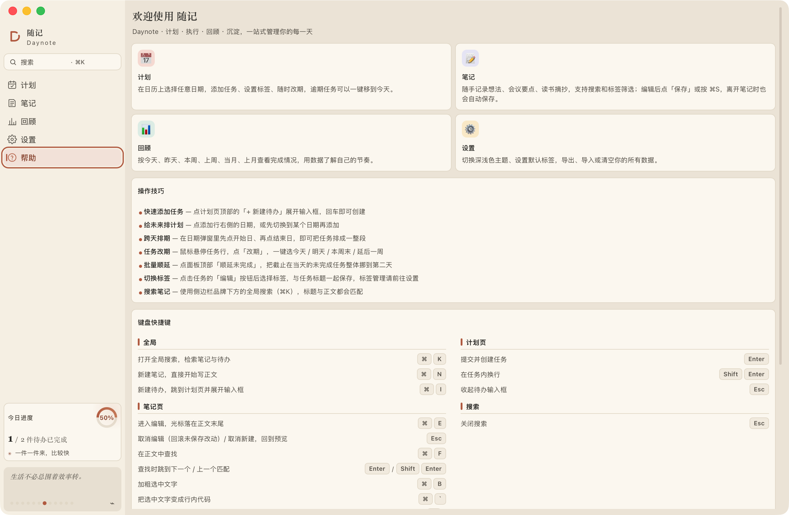

# 随记 Daynote

> 计划 · 执行 · 回顾 · 沉淀 —— 一站式管理你的每一天。

[](https://github.com/sanm00/Daynote/actions/workflows/ci.yml)
[](./LICENSE)
[](./docs/screenshots)

简体中文 · [English](./README.en.md)

一个**本地优先**的桌面笔记与待办应用：左边日历排计划，右边随手记笔记，按周/月回顾完成情况。数据只存在你自己的电脑上，不上传服务器。

## 🖼 界面预览

| 计划 | 笔记 |
| --- | --- |
|  |  |

| 回顾 | 搜索 |
| --- | --- |
|  |  |

| 设置 | 帮助 |
| --- | --- |
|  |  |

## ✨ 功能特性

- **计划** — 月历选择任意日期，添加任务、设置标签，随时「改期」到明天 / 本周末 / 延后一周；逾期任务一键移到今天；支持批量「顺延未完成」。
- **笔记** — Markdown 实时渲染（标题、列表、待办、引用、代码块、加粗、行内代码）；编辑后点「保存」或按 ⌘S 写入，离开笔记时也会自动保存；支持标签筛选与正文内查找（⌘F）。
- **回顾** — 按今天 / 昨天 / 本周 / 上周 / 当月 / 上月查看完成量、完成率、逾期、有产出天数与标签分布，图表支持柱状 / 折线切换。
- **搜索** — ⌘K 全局搜索，一次检索笔记标题、正文与待办，命中关键词高亮，点击直接跳转并定位。
- **外观与数据** — 浅色 / 深色 / 跟随系统主题；自定义标签名称、颜色与顺序，设置默认标签；支持导出 / 导入 JSON 备份与清空数据。
- **本地优先** — 任务与笔记仅保存在本机；写入采用原子替换并保留最近 20 份自动备份；应用内二次确认弹框，代替不稳定的系统弹窗。

## 🛠 技术栈

| 层 | 选型 |
| --- | --- |
| 桌面框架 | Tauri 2 |
| 前端 | React 18 + TypeScript 5.7 |
| 构建 | Vite 6 |
| 状态 | Zustand 5 |
| 后端 | Rust（serde / serde_json） |
| 测试 | Vitest（前端）+ cargo test（Rust） |

## 📋 环境要求

- Node.js 18+ 与 npm
- Rust（`rust-version = 1.90`）与 Cargo
- macOS / Windows / Linux（Tauri 支持的桌面平台）

## 🚀 快速开始

```bash
# 安装依赖
npm install

# 桌面开发模式（推荐）
npm run tauri dev

# 仅前端开发（浏览器内运行，数据回退到 localStorage）
npm run dev
```

构建正式版：

```bash
npm run tauri build
```

## 📜 可用脚本

| 命令 | 说明 |
| --- | --- |
| `npm run dev` | 启动 Vite 前端开发服务器（端口 1420） |
| `npm run tauri dev` | 启动 Tauri 桌面应用（开发模式） |
| `npm run build` | 类型检查并构建前端产物到 `dist/` |
| `npm run tauri build` | 打包正式版安装包 |
| `npm run typecheck` | 仅运行 `tsc --noEmit` |
| `npm run test` | 运行前端单元测试（Vitest） |
| `npm run test:watch` | 监听模式运行前端测试 |

## 💾 数据与存储

数据以 JSON 文件形式保存在本机：

- **开发版（`npm run tauri dev`）**：`src-tauri/data/`
- **正式版**：`~/.daynote/`

目录内容：

```
<数据目录>/
├── state.json    设置与标签（主题、默认标签、标签列表等）
├── tasks.json    任务
├── notes.json    笔记
├── images/       粘贴的图片（按内容哈希命名，重复图片复用）
└── backups/      最近 20 份自动备份（内容变化时生成）
```

写入采用「写临时文件 + 原子替换」，内容无变化时不重写、不产生备份。设置页「关于」中可查看当前实际存储位置；也可随时导出 JSON 备份。

图片 Demo：在笔记编辑模式中按 ⌘V / Ctrl+V 粘贴剪贴板图片，支持 PNG、JPEG、GIF、WebP，单张最大 10 MB。正文保存 `` 形式的相对引用，预览时读取图片。浏览器开发模式将图片保存在 IndexedDB，刷新后仍可展示。删除引用或取消编辑暂不删除图片文件。

当前 JSON 导出和自动备份不包含图片文件；迁移或备份图片时需同时复制数据目录中的 `images/`。图片完整备份和未引用图片清理尚未实现。

## 📁 目录结构

```
.
├── src/                     前端
│   ├── components/          通用组件（Sidebar、DatePop、ConfirmHost…）
│   ├── views/               页面
│   │   ├── plan/            计划页
│   │   ├── notes/           笔记页
│   │   ├── review/          回顾页
│   │   ├── search/          搜索页
│   │   ├── settings/        设置页
│   │   └── help/            帮助页
│   ├── store/               Zustand 状态（data / ui / persist 切片 + 自动持久化）
│   ├── lib/                 纯函数与工具（selectors、stats、markdown、date…）
│   └── styles/              样式
├── src-tauri/               Tauri（Rust）后端
│   └── src/
│       ├── models.rs        数据模型
│       ├── paths.rs         存储路径解析
│       ├── storage.rs       读写与备份
│       ├── commands.rs      IPC 命令
│       └── lib.rs           应用入口
└── docs/                    需求文档与设计稿
```

## ⌨️ 键盘快捷键

| 分组 | 快捷键 | 作用 |
| --- | --- | --- |
| 全局 | `⌘ K` | 打开全局搜索 |
| 全局 | `⌘ N` | 新建笔记 |
| 全局 | `⌘ I` | 新建待办 |
| 计划页 | `Enter` | 提交并创建任务 |
| 计划页 | `Shift Enter` | 在任务内换行 |
| 计划页 | `Esc` | 收起待办输入框 |
| 笔记页 | `⌘ E` | 进入编辑 |
| 笔记页 | `Esc` | 取消编辑（回滚未保存改动）/ 取消新建 |
| 笔记页 | `⌘ F` | 在正文中查找 |
| 笔记页 | `⌘ B` | 加粗选中文字 |
| 笔记页 | `` ⌘ ` `` | 行内代码 |
| 笔记页 | `⌘ /` | 插入 / 移除代码块 |
| 笔记页 | `Tab` / `Shift Tab` | 增加 / 减少缩进 |
| 搜索 | `Esc` | 关闭搜索 |

## 🧪 开发与测试

```bash
npm run typecheck                                                 # 前端类型检查
npm run test                                                      # 前端单元测试
cargo test  --manifest-path src-tauri/Cargo.toml                  # Rust 单元测试
cargo clippy --manifest-path src-tauri/Cargo.toml --all-targets   # Rust lint
```

## ❓ 常见问题

- **数据会上传服务器吗？** 不会。任务与笔记仅保存在本机，详见上文「数据与存储」。
- **换电脑如何迁移？** 旧设备设置页点「导出」得到 JSON，新设备点「导入」即可恢复。
- **为什么任务显示「已逾期」？** 安排日期已过但未勾选完成；左侧「逾期未完成」卡片可一键移到今天。

更多说明见应用内「帮助」页。

## 🤝 贡献

Issues 与 Pull Request 欢迎。提交前请先阅读 [CONTRIBUTING.md](./CONTRIBUTING.md)，并确保 `npm run typecheck`、`npm run test` 与 `cargo clippy` / `cargo test` 通过。

## 📄 许可证

本项目基于 [Apache License 2.0](./LICENSE) 授权，详见 [LICENSE](./LICENSE) 与 [NOTICE](./NOTICE)。
